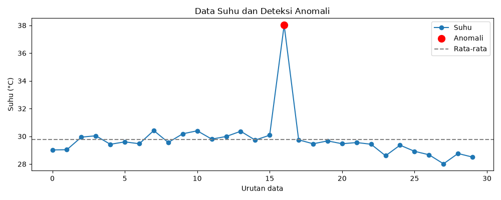
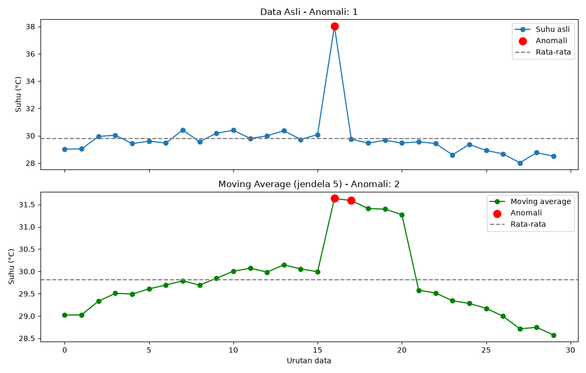
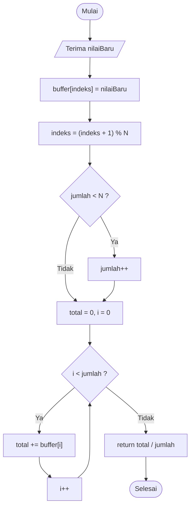

# Praktikum Modul 5 - Pengolahan dan Analisis Data IoT

## 1. Penjelasan Singkat Percobaan
Pada praktikum Modul 5 ini dilakukan dua percobaan utama mengenai pemrosesan, analisis, dan visualisasi data pada arsitektur Internet of Things (IoT):
1. **Percobaan 5A (Edge Computing / On-Device Processing):** Mengimplementasikan algoritma penyaringan data langsung pada mikrokontroler (ESP8266/ESP32) menggunakan metode *Moving Average* berbasis *circular buffer*, pemantauan nilai ekstrem (suhu minimum dan maksimum), serta perhitungan statistik lanjutan berupa simpangan baku (*standard deviation*). Pengolahan di sisi *edge* ini berfungsi untuk mereduksi *noise*, menstabilkan fluktuasi sinyal sensor sebelum dikirim, dan mengurangi beban transmisi jaringan.
2. **Percobaan 5B (Cloud/Server Analytics & Visualization):** Mengimplementasikan sistem pengiriman data berkala (*mock sensor*) dari mikrokontroler melalui protokol MQTT ke broker publik, yang kemudian diakuisisi oleh skrip Python di sisi komputer/server. Data yang masuk divalidasi, disimpan secara terstruktur ke dalam file CSV, dianalisis secara statistik menggunakan *Z-score* untuk mendeteksi data anomali (*outlier*), serta divisualisasikan dalam bentuk grafik deret waktu (*time-series chart*).

---

## 2. Library yang Digunakan

### Sisi Perangkat (ESP8266 / Arduino C++)
- **`ESP8266WiFi.h`**: Menyediakan fungsi manajemen konektivitas jaringan Wi-Fi untuk menghubungkan NodeMCU ESP8266 ke Access Point/Internet.
- **`PubSubClient.h`**: Library client MQTT untuk menghubungkan perangkat ke broker MQTT, mempublikasikan (*publish*) data sensor, dan berlangganan (*subscribe*) topic.
- **`ArduinoJson.h`**: Digunakan untuk serialisasi data sensor ke format JSON sebelum dipublikasikan melalui MQTT.
- **`math.h`**: Menyediakan fungsi-fungsi matematika komputasi seperti `sin()` untuk simulasi osilasi suhu dan `sqrt()` untuk perhitungan simpangan baku.

### Sisi Komputer / Server (Python)
- **`paho-mqtt` (`paho.mqtt.client`)**: Client MQTT untuk Python yang bertugas menghubungkan komputer ke broker, menangani *event listener* (`on_connect`, `on_message`), serta mengakuisisi payload pesan secara asinkron.
- **`pandas`**: Library analisis dan manipulasi data berkinerja tinggi untuk mengelola struktur *DataFrame*, kalkulasi statistik agregat (*mean*, *standard deviation*, *rolling average*), pembacaan/penyimpanan file CSV, serta deteksi anomali.
- **`matplotlib` (`matplotlib.pyplot`)**: Library visualisasi untuk menghasilkan grafik 2D (*line chart*, *scatter plot*) yang memetakan tren suhu, batas rata-rata, dan penanda visual anomali.
- **`json` & `time`**: Modul bawaan Python untuk *parsing* string payload JSON dan pembuatan penanda waktu (*timestamp*).

---

## 3. Penjelasan Kode

### Percobaan 5A: Pengolahan Data Suhu di Sisi Perangkat (Edge Computing)

Percobaan 5A menguji komputasi *Moving Average* dan pemantauan nilai minimum/maksimum secara langsung pada mikrokontroler tanpa bergantung pada server eksternal.

#### Inisialisasi Buffer dan Variabel Statistik
```cpp
const int N = 5;          // jumlah sampel moving average
float buffer[N];          // menyimpan N pembacaan terakhir
int indeks = 0;           // posisi penulisan berikutnya pada buffer
int jumlah = 0;           // jumlah sampel yang sudah terisi

float suhuMin = 1000.0;
float suhuMax = -1000.0;
```
- `N`: Menentukan ukuran jendela (*window size*) dari *moving average* (5 sampel).
- `buffer[N]`: Larik (*array*) melingkar yang menampung 5 nilai suhu terbaru.
- `indeks`: Penunjuk (*pointer*) posisi elemen yang akan ditulis berikutnya.
- `jumlah`: Penghitung sampel yang sudah masuk ke buffer, bertambah hingga mencapai batas maksimal `N`.
- `suhuMin` & `suhuMax`: Nilai awal ekstrem yang diset ke `1000.0` dan `-1000.0` sebagai batas pembanding pencatatan nilai terendah dan tertinggi.

#### Fungsi `hitungMovingAverage()`
```cpp
float hitungMovingAverage(float nilaiBaru) {
  buffer[indeks] = nilaiBaru;
  indeks = (indeks + 1) % N;
  
  if (jumlah < N) {
    jumlah++;
  }

  float total = 0;
  for (int i = 0; i < jumlah; i++) {
    total += buffer[i];
  }
  
  return total / jumlah;
}
```
- **Penyimpanan Melingkar (*Circular Buffer*)**: Nilai pembacaan baru dimasukkan ke `buffer[indeks]`. Selanjutnya `indeks = (indeks + 1) % N` memutar posisi indeks (0 $\rightarrow$ 1 $\rightarrow$ 2 $\rightarrow$ 3 $\rightarrow$ 4 $\rightarrow$ 0) sehingga data paling lama akan otomatis tertimpa tanpa perlu menggeser elemen memori.
- **Akumulasi dan Rata-rata**: Sebelum buffer terisi penuh ($jumlah < N$), rata-rata dihitung berdasarkan jumlah data yang tersedia. Setelah penuh, pembagi akan selalu bernilai $N=5$.

#### Fungsi `bacaSuhuMock()`
```cpp
float bacaSuhuMock() {
  static unsigned long jumlahBaca = 0;
  jumlahBaca++;

  // Suhu dasar berubah secara bertahap
  float suhuDasar = 28.0 + 2.0 * sin(jumlahBaca * 0.08);

  // Noise kecil untuk mensimulasikan fluktuasi sensor
  float noise = random(-5, 6) * 0.1;

  float suhu = suhuDasar + noise;

  // Lonjakan suhu setiap 25 pembacaan untuk simulasi anomali
  if (jumlahBaca % 25 == 0) {
    suhu += 8.0;
  }

  return suhu;
}
```
- Menghasilkan data simulasi suhu realistis menggunakan fungsi trigonometri sinus sebagai suhu dasar berkisar antara 26°C hingga 30°C.
- Menambahkan *noise* acak berkisar antara -0.5°C hingga +0.5°C.
- Menginjeksikan lonjakan anomali (+8.0°C) setiap kelipatan 25 pembacaan untuk menguji ketahanan filter dan algoritma deteksi.

#### Fungsi `setup()` dan `loop()`
```cpp
void setup() {
  Serial.begin(115200);
}

void loop() {
  float suhu = bacaSuhuMock();

  if (isnan(suhu)) {
    Serial.println("Pembacaan gagal, data diabaikan");
  } else {
    float suhuFilter = hitungMovingAverage(suhu);

    if (suhu < suhuMin) suhuMin = suhu;
    if (suhu > suhuMax) suhuMax = suhu;

    Serial.print("Mentah: ");
    Serial.print(suhu);
    Serial.print(" | Filter: ");
    Serial.print(suhuFilter);
    Serial.print(" | Min: ");
    Serial.print(suhuMin);
    Serial.print(" | Max: ");
    Serial.println(suhuMax);
  }

  delay(2000);
}
```
- Setiap 2 detik, suhu dibaca, diproses melalui `hitungMovingAverage()`, dievaluasi nilai ekstremnya, dan dicetak ke Serial Monitor.

---

### Percobaan 5B: Pengiriman, Akuisisi, Analisis, dan Visualisasi Data

Percobaan 5B memisahkan tugas antara mikrokontroler sebagai produsen data (*publisher*) dan komputer/server sebagai konsumen data (*subscriber*, *analyst*, dan *visualizer*).

#### 1. Pengirim Data ESP8266 (`percobaan_5b_pengirim.ino`)
Program ini menghubungkan ESP8266 ke WiFi dan broker MQTT, kemudian mempublikasikan data suhu dalam format JSON secara berkala:
```cpp
if (millis() - waktuTerakhirPublish > intervalPublish) {
  waktuTerakhirPublish = millis();
  
  float suhuDummy = bacaSuhuMock(); 
  
  JsonDocument doc;
  doc["suhu"] = suhuDummy;
  
  char buffer[128];
  serializeJson(doc, buffer);
  client.publish(topicData, buffer);
  
  Serial.print("Data terkirim: ");
  Serial.println(buffer);
}
```
- Menggunakan pewaktuan *non-blocking* `millis()` dengan interval 5 detik (`intervalPublish = 5000`).
- Membungkus data float ke dalam dokumen JSON bertopik `IoT/klmpk0/data`.

#### 2. Skrip Akuisisi dan Analisis Python (`analisis_suhu_percobaan_5B.py`)

##### Tahap 1: Akuisisi Data melalui MQTT
```python
def on_message(client, userdata, msg):
    try:
        payload = json.loads(msg.payload.decode())
        suhu = float(payload["suhu"])
    except (ValueError, KeyError):
        print("Data tidak valid, diabaikan")
        return

    data.append({"waktu": time.strftime("%Y-%m-%d %H:%M:%S"), "suhu": suhu})
    print(f"[{len(data)}/{JUMLAH_SAMPEL}] suhu = {suhu}")

    if len(data) >= JUMLAH_SAMPEL:
        client.disconnect()
```
- Fungsi callback `on_message` mem-parsing data JSON yang masuk dengan perlindungan blok `try-except` terhadap kerusakan payload.
- Data yang valid disimpan ke dalam *list of dictionaries* bersama penanda waktu (*timestamp*). Begitu data mencapai 30 sampel (`JUMLAH_SAMPEL = 30`), koneksi MQTT diputus (`client.disconnect()`) agar alur berlanjut ke tahap pengolahan.

##### Tahap 2: Penyimpanan ke CSV
```python
df = pd.DataFrame(data)
df.to_csv("data_suhu.csv", index=False)
```
- Mengonversi data ke objek *DataFrame* Pandas dan menyimpannya sebagai file tabel `data_suhu.csv`.

##### Tahap 3: Perhitungan Statistik dan Deteksi Anomali Z-score
```python
rata2 = df["suhu"].mean()
std = df["suhu"].std()

if std == 0:
    df["zscore"] = 0.0
else:
    df["zscore"] = (df["suhu"] - rata2) / std
df["anomali"] = df["zscore"].abs() > 2
```
- Menghitung rata-rata ($\mu$) dan simpangan baku ($\sigma$) keseluruhan data.
- Menghitung *Z-score* tiap data:
  $$Z = \frac{x - \mu}{\sigma}$$
- Mengklasifikasikan anomali apabila nilai absolut *Z-score* melebihi ambang batas 2 ($|Z| > 2$).

##### Tahap 4: Visualisasi Grafik
```python
plt.figure(figsize=(10, 4))
plt.plot(df.index, df["suhu"], marker="o", label="Suhu")
anom = df[df["anomali"]]
plt.scatter(anom.index, anom["suhu"], color="red", s=100, label="Anomali", zorder=3)
plt.axhline(rata2, color="gray", linestyle="--", label="Rata-rata")
plt.xlabel("Urutan data")
plt.ylabel("Suhu (°C)")
plt.title("Data Suhu dan Deteksi Anomali")
plt.legend()
plt.tight_layout()
plt.savefig("grafik_suhu.png")
plt.show()
```
- Menggambar grafik deret waktu dengan penanda titik bulat, garis horizontal rata-rata, dan lingkaran merah mencolok pada titik yang terdeteksi sebagai anomali. Hasil grafik disimpan ke `grafik_suhu.png`.

---

### Modifikasi Percobaan 5A: Perhitungan Simpangan Baku pada Buffer ESP8266

Pada file [`percobaan_5A_modifikasi.ino`](code/percobaan_5A_modifikasi.ino), ditambahkan fungsi penghitungan simpangan baku (*standard deviation*) secara lokal langsung dari data di dalam buffer melingkar.

```cpp
float hitungSimpanganBaku() {
  if (jumlah < 2) return 0.0; // butuh minimal 2 data

  // 1. Hitung rata-rata data pada buffer
  float total = 0;
  for (int i = 0; i < jumlah; i++) {
    total += buffer[i];
  }
  float rerata = total / jumlah;

  // 2. Hitung jumlah kuadrat deviasi selisih
  float sumKuadrat = 0;
  for (int i = 0; i < jumlah; i++) {
    float selisih = buffer[i] - rerata;
    sumKuadrat += selisih * selisih;
  }

  // 3. Simpangan baku sampel dengan derajat kebebasan n - 1
  return sqrt(sumKuadrat / (jumlah - 1));
}
```

**Penjelasan Perubahan:**
1. **Validasi Jumlah Sampel:** Penghitungan membutuhkan minimal $n \ge 2$ untuk menghindari pembagian dengan nol saat menghitung varians sampel ($n - 1$).
2. **Kalkulasi Kuadrat Selisih:** Mengukur seberapa besar penyebaran data pembacaan terhadap nilai rata-ratanya pada jendela geser $N = 5$.
3. **Penyajian Data:** Nilai simpangan baku dicetak bersamaan dengan data mentah, moving average, nilai minimum, dan nilai maksimum ke Serial Monitor.

---

### Modifikasi Percobaan 5B: Deteksi Anomali Z-score Berbasis Moving Average

Pada file [`analisis_suhu_modifikasi.py`](code/analisis_suhu_modifikasi.py), skrip Python dimodifikasi untuk membandingkan efektivitas deteksi anomali antara data mentah dengan data yang telah dihaluskan (*smoothed*) menggunakan *rolling moving average* ($N=5$).

```python
# Moving average jendela 5 lalu deteksi anomali
df["suhu_ma"] = df["suhu"].rolling(window=JUMLAH_DATA, min_periods=1).mean()
df["zscore_ma"], rata2_ma, std_ma = hitung_zscore(df["suhu_ma"])
df["anomali_ma"] = df["zscore_ma"].abs() > AMBANG_Z
```
- Skrip menampilkan visualisasi komparatif dua subplot: subplot atas untuk data asli dan subplot bawah untuk data hasil *moving average*, memperlihatkan bagaimana *smoothing* mempengaruhi ambang batas dan sensitivitas deteksi anomali.

---

## 4. Hasil Pengamatan

### 4.1 Tabel 5.1 Hasil Pengolahan Data Suhu pada ESP32 / ESP8266
Tabel berikut menunjukkan hasil pemrosesan data suhu di sisi mikrokontroler menggunakan filter *Moving Average* ($N = 5$) serta pelacakan nilai suhu minimum dan maksimum:

| No. | Waktu Pengiriman (s) | Suhu Mentah (°C) | Moving Average (°C) | Suhu Minimum (°C) | Suhu Maksimum (°C) |
| :---: | :---: | :---: | :---: | :---: | :---: |
| 1 | 0 | 29.42 | 29.08 | 27.82 | 29.42 |
| 2 | 5 | 29.93 | 29.27 | 27.82 | 29.93 |
| 3 | 10 | 29.74 | 29.35 | 27.82 | 29.93 |
| 4 | 15 | 29.74 | 29.53 | 27.82 | 29.93 |
| 5 | 20 | 29.52 | 29.67 | 27.82 | 29.93 |
| 6 | 25 | 29.40 | 29.67 | 27.82 | 29.93 |
| 7 | 30 | 29.76 | 29.63 | 27.82 | 29.93 |
| 8 | 35 | 30.42 | 29.77 | 27.82 | 30.42 |
| 9 | 40 | 29.86 | 29.79 | 27.82 | 30.42 |
| 10 | 45 | 29.98 | 29.88 | 27.82 | 30.42 |

---

### 4.2 Tabel 5.2 Hasil Akuisisi dan Analisis Data Suhu melalui MQTT
Tabel berikut memuat 20 sampel data hasil transmisi MQTT yang diakuisisi oleh skrip Python, dihitung *Z-score*-nya, dievaluasi status anomalinya ($|Z| > 2$), dan disimpan ke dalam file CSV:

| No. | Waktu Penerimaan | Suhu (°C) | Z-score | Status Anomali | Status Penyimpanan CSV |
| :---: | :---: | :---: | :---: | :---: | :---: |
| 1 | 2026-10-21 12:28:09 | 29.01 | -0.45 | Normal | Tersimpan |
| 2 | 2026-10-21 12:28:14 | 29.03 | -0.44 | Normal | Tersimpan |
| 3 | 2026-10-21 12:28:19 | 29.94 | 0.10 | Normal | Tersimpan |
| 4 | 2026-10-21 12:28:24 | 30.03 | 0.16 | Normal | Tersimpan |
| 5 | 2026-10-21 12:28:29 | 29.42 | -0.21 | Normal | Tersimpan |
| 6 | 2026-10-21 12:28:34 | 29.60 | -0.10 | Normal | Tersimpan |
| 7 | 2026-10-21 12:28:39 | 29.46 | -0.18 | Normal | Tersimpan |
| 8 | 2026-10-21 12:28:44 | 30.41 | 0.39 | Normal | Tersimpan |
| 9 | 2026-10-21 12:28:49 | 29.55 | -0.13 | Normal | Tersimpan |
| 10 | 2026-10-21 12:28:54 | 30.18 | 0.25 | Normal | Tersimpan |
| 11 | 2026-10-21 12:28:59 | 30.39 | 0.38 | Normal | Tersimpan |
| 12 | 2026-10-21 12:29:04 | 29.79 | 0.02 | Normal | Tersimpan |
| 13 | 2026-10-21 12:29:09 | 29.98 | 0.13 | Normal | Tersimpan |
| 14 | 2026-10-21 12:29:14 | 30.36 | 0.36 | Normal | Tersimpan |
| 15 | 2026-10-21 12:29:19 | 29.72 | -0.03 | Normal | Tersimpan |
| 16 | 2026-10-21 12:29:24 | 30.07 | 0.19 | Normal | Tersimpan |
| 17 | 2026-10-21 12:29:29 | 38.01 | 4.94 | Anomali | Tersimpan |
| 18 | 2026-10-21 12:29:34 | 29.74 | -0.01 | Normal | Tersimpan |
| 19 | 2026-10-21 12:29:39 | 29.46 | -0.18 | Normal | Tersimpan |
| 20 | 2026-10-21 12:29:44 | 29.66 | -0.06 | Normal | Tersimpan |

---

### 4.3 Visualisasi Grafik Hasil Analisis

#### Grafik Suhu dan Deteksi Anomali (Percobaan 5B)
Berikut adalah grafik visualisasi hasil analisis skrip Python terhadap 30 data suhu, di mana titik ke-17 dengan suhu 38.01°C terdeteksi secara jelas sebagai anomali (berwarna merah):



#### Grafik Perbandingan Modifikasi (Data Asli vs Moving Average)
Berikut adalah perbandingan grafik deteksi anomali antara data mentah dengan data setelah diaplikasikan moving average:



---

## 5. Pertanyaan

### 5.1 Pertanyaan Praktikum Percobaan 5A
1. Gambarkan diagram alur (flowchart) proses perhitungan moving average pada fungsi hitungMovingAverage()!

    Jawaban : 



2. Jelaskan fungsi dari operasi `(indeks + 1) % N` pada program tersebut!

    Jawaban : Operasi ini membuat indeks buffer berputar: 0, 1, 2, 3, 4, lalu kembali ke 0. Data terbaru selalu menimpa data paling lama (circular buffer), sehingga buffer berisi N pembacaan terakhir tanpa perlu menggeser isi array dan tanpa indeks melewati batas array.

3. Apa dampaknya terhadap data hasil filter apabila nilai N diperbesar menjadi 20 atau diperkecil menjadi 2?

    Jawaban : 
    - **N = 20**: Data sangat halus, noise dan lonjakan sesaat teredam. Namun respons terhadap perubahan suhu nyata menjadi lambat (terjadi lag), dan membutuhkan 20 sampel (±40 detik) agar buffer terisi penuh. Penggunaan memori buffer juga lebih besar.
    - **N = 2**: Data hampir sama dengan data mentah, noise kurang teredam. Respons filter sangat cepat terhadap perubahan kondisi baru dan penggunaan memori sangat kecil.

---

### 5.2 Pertanyaan Praktikum Percobaan 5B
1. Jelaskan fungsi dari blok `try-except` pada fungsi `on_message()` dan apa yang terjadi apabila blok tersebut dihilangkan!

    Jawaban : Blok ini menangkap data yang rusak: `ValueError` jika payload bukan JSON valid atau nilai suhu tidak bisa diubah ke tipe `float`, dan `KeyError` jika kunci `"suhu"` tidak ditemukan di dalam payload. Ketika error terjadi, data tersebut diabaikan dan program tetap berjalan lancar. Jika blok tersebut dihilangkan, satu pesan yang rusak (misalnya dari publisher lain di broker publik) akan memunculkan *unhandled exception* sehingga program Python langsung terhenti sebelum 30 data terkumpul, yang mengakibatkan tahap penyimpanan CSV, analisis statistik, dan pembuatan grafik visualisasi gagal dijalankan.

2. Jelaskan arti nilai *z-score* dan mengapa batas $|z| > 2$ digunakan sebagai penentu anomali!

    Jawaban : *Z-score* menyatakan jarak sebuah nilai dari rata-rata dalam satuan simpangan baku ($z = \frac{x - \mu}{\sigma}$). Pada data berdistribusi normal, sekitar 95% data berada di dalam rentang $\pm 2$ simpangan baku, sehingga nilai di luar batas tersebut secara statistik hanya sekitar 5% dan tergolong kejadian langka atau tidak wajar (anomali). Batas 2 merupakan nilai kompromi optimal: jika ambang batas dibuat lebih kecil (misalnya 1), sistem akan memunculkan terlalu banyak alarm palsu (*false positive*); sedangkan jika dibuat lebih besar (misalnya 3), sistem berisiko melewatkan anomali yang lebih ringan (*false negative*).

3. Apa kelemahan metode *z-score* apabila data memiliki tren naik atau turun yang tajam?

    Jawaban : Rata-rata dan simpangan baku pada metode *z-score* standar dihitung dari keseluruhan populasi data dengan asumsi nilai mean konstan. Pada data yang memiliki tren naik atau turun tajam:
    - Simpangan baku ($\sigma$) akan membesar akibat rentang tren itu sendiri, sehingga lonjakan anomali sungguhan justru gagal terdeteksi karena pembaginya terlalu besar.
    - Nilai data di ujung tren awal atau akhir yang sebenarnya merupakan kondisi wajar justru dianggap sebagai anomali karena posisinya jauh dari rata-rata keseluruhan.
    - Rata-rata dan simpangan baku ikut terdistorsi (*biased*) oleh keberadaan nilai pencilan (*outlier*) itu sendiri. Solusi untuk mengatasi kelemahan ini adalah menerapkan *rolling z-score* (berjendela) atau melakukan *detrending* (menghilangkan tren) sebelum menghitung skor z.

---

### 5.3 Pertanyaan Analisis

1. Uraikan hasil tugas pada praktikum yang telah dilakukan pada setiap percobaan!

    Jawaban : Pada percobaan 5A, mikrokontroler ESP8266 berhasil memproses data suhu di sisi perangkat (*edge*) secara langsung menggunakan algoritma *moving average* dan pencatatan nilai minimum/maksimum serta simpangan baku. Pada percobaan 5B, data suhu dikirim melalui protokol MQTT dan program Python di sisi komputer berhasil mengakuisisi data tersebut, menyimpannya ke format CSV, melakukan analisis statistik deteksi anomali berbasis *z-score*, serta memvisualisasikannya ke dalam bentuk grafik.

2. Bandingkan pengolahan data di sisi perangkat (Percobaan 5A) dengan pengolahan data di sisi komputer (Percobaan 5B) dari segi kecepatan, kompleksitas analisis, dan kebutuhan sumber daya!

    Jawaban :
    - **Dari segi kecepatan:**
      - *Edge (Perangkat):* Sangat cepat (real-time) karena pemrosesan dilakukan langsung di chip tanpa latensi transmisi jaringan, sehingga mampu memicu aktuator seketika.
      - *Server / Komputer:* Memiliki jeda (latensi jaringan pengiriman MQTT) dan memerlukan waktu tunggu akumulasi sampel data sebelum proses analisis dapat dijalankan.
    - **Dari segi kompleksitas analisis:**
      - *Edge (Perangkat):* Analisis sederhana (seperti moving average, pelacakan min/max, dan simpangan baku dasar) akibat keterbatasan kapasitas CPU dan memori mikrokontroler.
      - *Server / Komputer:* Mampu menjalankan analisis statistik kompleks (z-score, machine learning, visualisasi grafik interaktif, dan kueri data historis jangka panjang).
    - **Dari segi kebutuhan sumber daya:**
      - *Edge (Perangkat):* Hemat bandwidth jaringan karena data mentah dapat difilter atau diringkas terlebih dahulu sebelum ditransmisikan, namun memiliki keterbatasan RAM dan daya komputasi.
      - *Server / Komputer:* Memiliki kapasitas komputasi dan ruang penyimpanan yang sangat besar, namun menuntut koneksi internet yang stabil serta mesin server/komputer yang harus menyala terus-menerus.

3. Bagaimana pengaruh pemilihan ukuran jendela *moving average* terhadap kualitas data dan kecepatan respons sistem kendali apabila data tersebut digunakan untuk mengendalikan aktuator?

    Jawaban : Pemilihan ukuran jendela moving average memiliki dampak langsung terhadap stabilitas data dan kecepatan respons sistem kendali:
    - **Jendela berukuran besar:** Menghasilkan kurva data yang sangat halus dan stabil sehingga aktuator terhindar dari siklus hidup-mati yang terlalu sering akibat noise (*chattering*). Namun, sistem mengalami kelambatan respons (lag), sehingga jika terjadi perubahan kondisi nyata yang drastis, aktuator akan terlambat bereaksi.
    - **Jendela berukuran kecil:** Memberikan respons sistem yang sangat cepat terhadap dinamika lingkungan, namun sinyal hasil filter masih rentan terhadap noise pembacaan sensor sehingga berisiko memicu aktuator secara keliru atau bereaksi berlebihan.
    - Oleh karena itu, ukuran jendela moving average harus disesuaikan secara seimbang dengan laju dinamika fisik dari proses yang dikendalikan.

4. Bagaimana hasil analisis dan deteksi anomali dapat dimanfaatkan untuk meningkatkan keandalan sistem IoT, misalnya pada sistem *smart farming* atau *smart home*?

    Jawaban :
    - **Pada Smart Farming:** Pembacaan data sensor suhu atau kelembapan tanah yang menyimpang drastis dapat segera diidentifikasi sebagai sensor rusak atau terlepas, sehingga sistem kendali irigasi otomatis tidak menyalakan atau mematikan pompa air berdasarkan data yang keliru, yang berpotensi merusak tanaman.
    - **Pada Smart Home:** Lonjakan suhu mendadak yang terdeteksi sebagai anomali dapat digunakan untuk memicu peringatan dini bahaya kebakaran atau indikasi malfungsi peralatan elektronik rumah tangga.
    - **Secara Umum:** Hasil deteksi anomali memungkinkan sistem untuk membuang (*filter out*) data cacat sebelum disimpan ke basis data, mengirimkan notifikasi pemeliharaan preventif (*predictive maintenance*), dan mencegah pengambilan keputusan otomatis yang salah, sehingga sistem IoT beroperasi jauh lebih andal dan menghasilkan basis data historis yang bersih.
